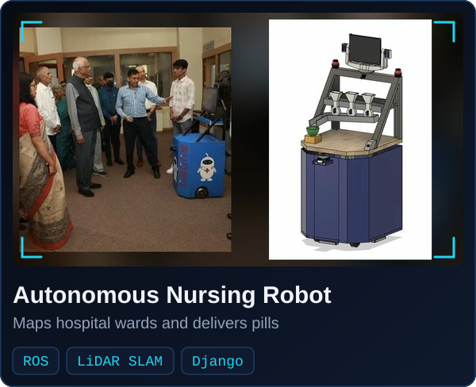
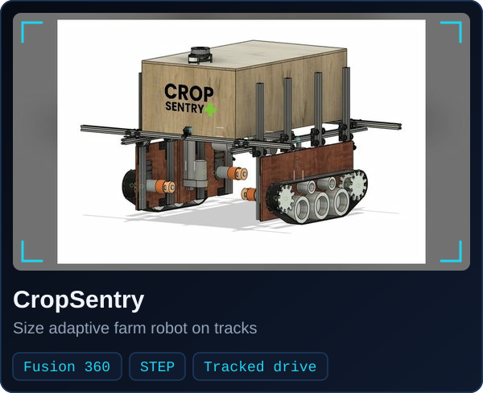
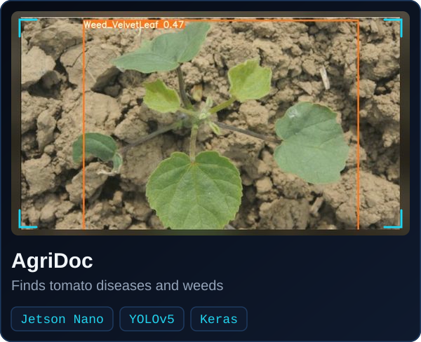
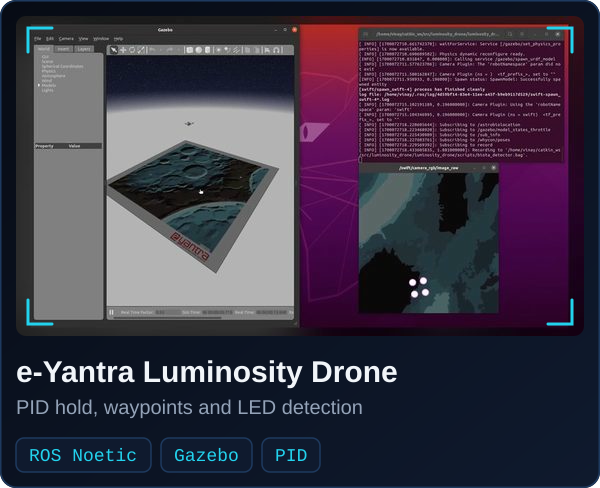
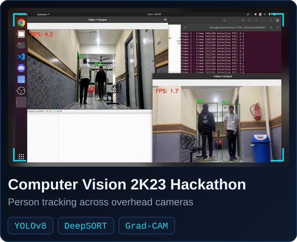
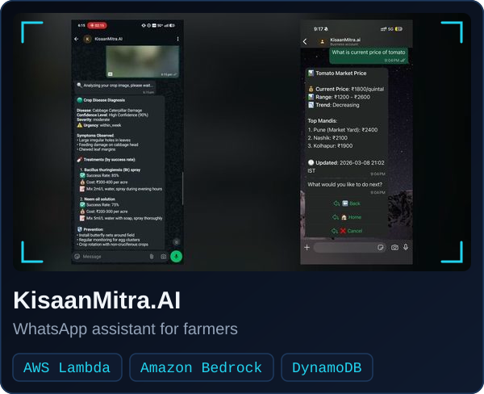

  
  
  

I build robots that drive, fly and see, from the CAD and the circuit boards to the code that runs on them.

<h2 align="center">🚀 Projects</h2>

  
  

  
  

  
  

<h2 align="center">⚙️ Tech Stack</h2>

  <b>Robotics</b> 
  
  
  
  
  
  

  <b>Vision &amp; ML</b> 
  
  
  
  
  
  
  

  <b>Design &amp; Engineering</b> 
  
  
  
  
  
  

  <b>Software &amp; Development</b> 
  
  
  
  
  
  
  
  

 

