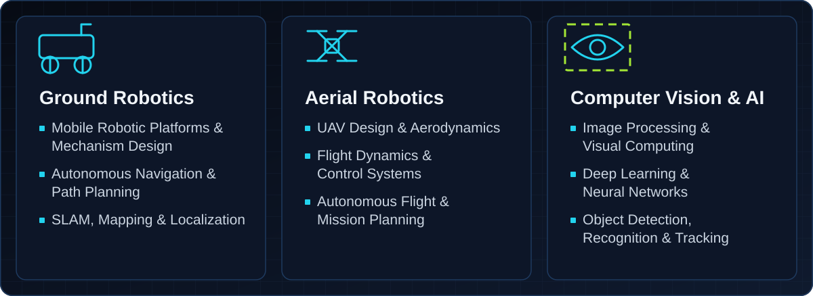
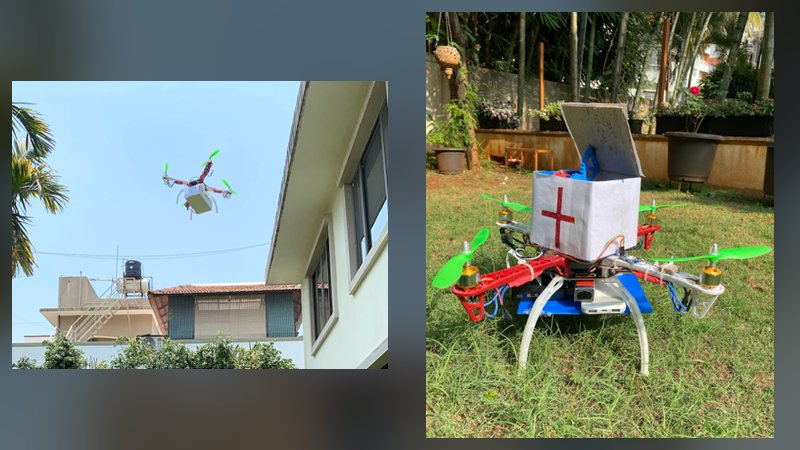
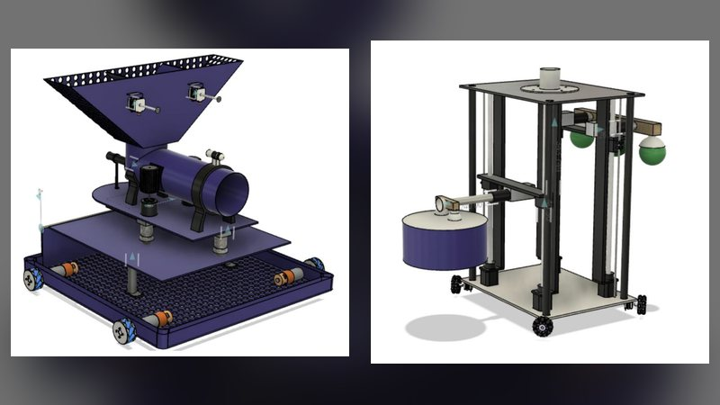
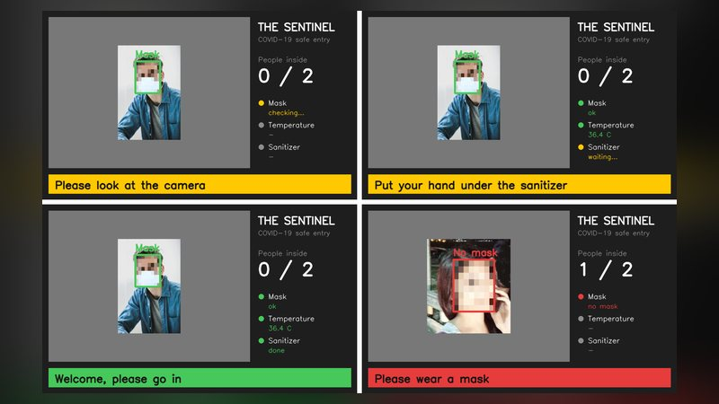
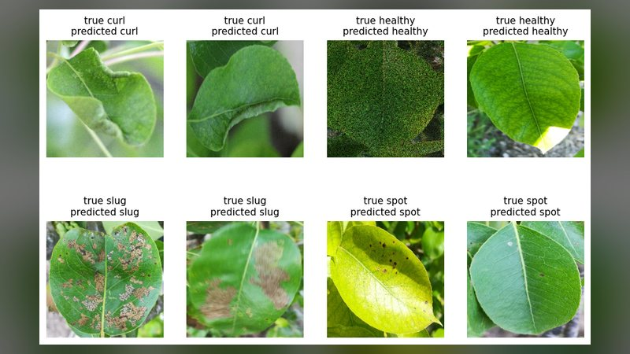

  
  
  

I build robots that drive, fly and see, from the CAD and the circuit boards to the code that runs on them.

## Featured repositories

<table>
  <tr>
    <td width="50%" valign="top">
       
      <a href="https://github.com/Patil-Vinay/Forest-cop-ter"><b>Forest-cop-ter</b></a> 
      <code>Raspberry Pi 4</code> <code>GSM</code> <code>GPS</code> <code>Keras</code> <code>Tkinter</code> 
      Rescue and fire watch drone with a live camera, GSM calls, GPS and a first aid box it can drop to someone lost in a forest.
    </td>
    <td width="50%" valign="top">
       
      <a href="https://github.com/Patil-Vinay/Robocon-2022"><b>DD Robocon 2022: Lagori</b></a> 
      <code>Fusion 360</code> <code>STEP</code> <code>Suction grippers</code> 
      Two robots for the Lagori theme. R1 shoots balls to break the pile of discs while R2 picks the discs up with suction cups and stacks them again.
    </td>
  </tr>
  <tr>
    <td width="50%" valign="top">
       
      <a href="https://github.com/Patil-Vinay/COVID-19-Safe-Entry-System"><b>The Sentinel: Safe Entry System</b></a> 
      <code>Raspberry Pi</code> <code>TFLite</code> <code>MLX90614</code> <code>Flask</code> 
      Checks for a face mask and body temperature, waits for the hands to be sanitised, opens the door and counts the people inside.
    </td>
    <td width="50%" valign="top">
       
      <a href="https://github.com/Patil-Vinay/Disease-Detection-Diamos"><b>Pear Leaf Disease Detection</b></a> 
      <code>Siamese network</code> <code>EfficientNetB0</code> <code>MobileNetV2</code> <code>TensorFlow</code> 
      Siamese networks on the DiaMOS Plant dataset, tested on leaves the model never saw and compared step by step against a plain classifier.
    </td>
  </tr>
</table>

## Toolbox

<table>
  <tr>
    <td><b>Robotics</b></td>
    <td></td>
    <td>Gazebo, SLAM (gmapping, Hector, Cartographer), AMCL, PID and ADRC control, NVIDIA Jetson</td>
  </tr>
  <tr>
    <td><b>Vision and ML</b></td>
    <td></td>
    <td>Keras, TFLite, YOLOv5 and YOLOv8, DeepSORT, Grad-CAM</td>
  </tr>
  <tr>
    <td><b>Design</b></td>
    <td></td>
    <td>Fusion 360, SolidWorks, AutoCAD, EasyEDA, Eagle, KiCad, Simulink</td>
  </tr>
  <tr>
    <td><b>Code and web</b></td>
    <td></td>
    <td>Embedded C on Arduino, web dashboards for my robots</td>
  </tr>
</table>

 

