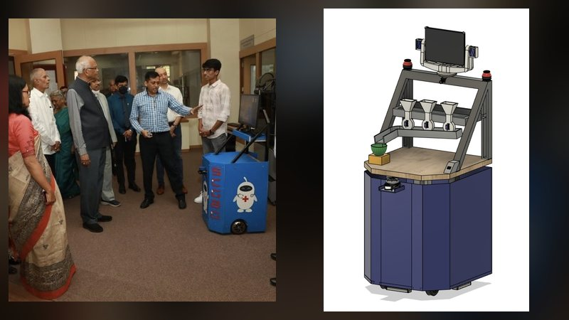
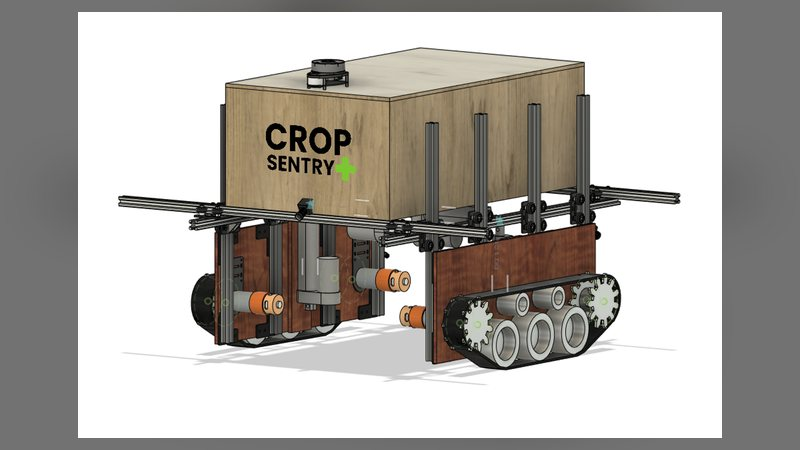
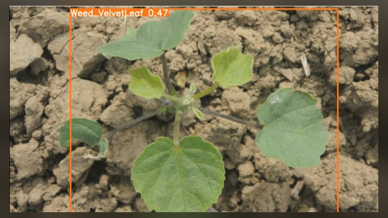
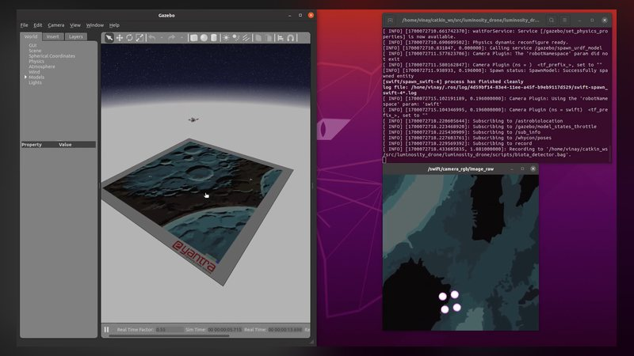
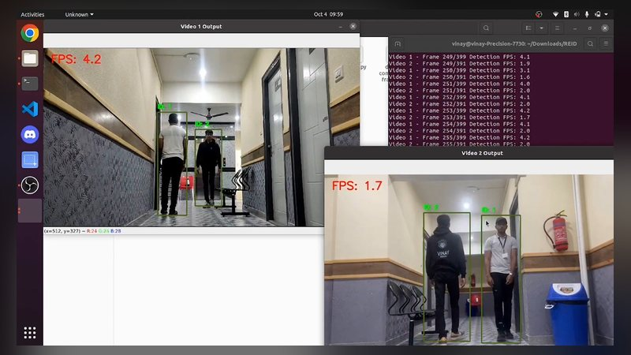

  
  
  

I like machines that move on their own. Most of what I build sits where mechanics, electronics and software meet: I draw the robot in Fusion 360 or SolidWorks, lay out the boards, wire up an Arduino, Raspberry Pi or Jetson and then write the ROS, control and vision code that makes it drive or fly.

This is where the code, CAD files and notebooks live. The full story of each project is on my [portfolio](https://patil-vinay.github.io/patil-vinay/).

<table>
  <tr>
    <td width="33%" valign="top">
      <b>On the ground</b> 
      ROS navigation, LiDAR SLAM and AMCL, robots for hospitals and farms, two Robocon seasons
    </td>
    <td width="33%" valign="top">
      <b>In the air</b> 
      Quadcopter builds, PID position hold, waypoint navigation in Gazebo, payload drop systems
    </td>
    <td width="33%" valign="top">
      <b>Seeing things</b> 
      OpenCV, CNNs and Siamese networks, YOLO and DeepSORT tracking, TFLite on edge boards
    </td>
  </tr>
</table>

## Featured repositories

<table>
  <tr><td colspan="2"><b>Ground robots</b></td></tr>
  <tr>
    <td width="50%" valign="top">
       
      <a href="https://github.com/Patil-Vinay/Autonomous-Nursing-Robot"><b>Autonomous Nursing Robot</b></a> 
      <code>Django</code> <code>Arduino</code> <code>Firebase</code> <code>Agora</code> <code>ROS</code> 
      Hospital robot that maps the ward with a 2D LiDAR, drives to each bed, dispenses pills and checks temperature. 
      Inside: Django control site with video calls and pill dispensing, Arduino sketches for the dispenser and pan tilt screen, thermal camera script and 3D models
    </td>
    <td width="50%" valign="top">
       
      <a href="https://github.com/Patil-Vinay/CropSentry"><b>CropSentry</b></a> 
      <code>Fusion 360</code> <code>STEP</code> <code>Tracked drive</code> <code>RPLidar</code> 
      Farm robot on tracks that changes its width and height to fit the crop rows and checks plants for deficiencies, diseases and weeds. 
      Inside: Fusion 360 archive and STEP models of the full robot, gantry, actuators, lidar and spray nozzle
    </td>
  </tr>
  <tr>
    <td width="50%" valign="top">
       
      <a href="https://github.com/Patil-Vinay/AgriDoc"><b>AgriDoc</b></a> 
      <code>Jetson Nano</code> <code>YOLOv5</code> <code>Keras</code> <code>OpenCV</code> 
      Farm robot built around a Jetson Nano that finds diseased tomato leaves and weeds so it can spray only where needed. 
      Inside: tomato disease detection script with its trained Keras model, YOLOv5 weed detection notebook with weights and evaluation curves
    </td>
    <td width="50%" valign="top">
       
      <a href="https://github.com/Patil-Vinay/Robocon-2022"><b>DD Robocon 2022: Lagori</b></a> 
      <code>Fusion 360</code> <code>STEP</code> <code>Suction grippers</code> 
      Two robots for the Lagori theme. R1 shoots balls to break the pile of discs while R2 picks the discs up with suction cups and stacks them again. 
      Inside: STEP exports of both robots, renders, assembly animations and a parts list
    </td>
  </tr>
  <tr><td colspan="2"><b>Drones</b></td></tr>
  <tr>
    <td width="50%" valign="top">
       
      <a href="https://github.com/Patil-Vinay/Forest-cop-ter"><b>Forest-cop-ter</b></a> 
      <code>Raspberry Pi 4</code> <code>GSM</code> <code>GPS</code> <code>Keras</code> <code>Tkinter</code> 
      Rescue and fire watch drone with a live camera, GSM calls, GPS and a first aid box it can drop to someone lost in a forest. 
      Inside: Raspberry Pi app with a Tkinter control screen, test scripts for each sensor and module, fire prediction and synthetic data notebooks
    </td>
    <td width="50%" valign="top">
       
      <a href="https://github.com/Patil-Vinay/Eyantra-eyrc2023-luminosity-drone"><b>e-Yantra Luminosity Drone</b></a> 
      <code>ROS Noetic</code> <code>Gazebo</code> <code>PID</code> <code>OpenCV</code> 
      e-Yantra Robotics Competition 2023-24 tasks, first in Gazebo and then on the real drone. 
      Inside: ROS nodes for PID position hold, waypoint navigation and LED cluster detection
    </td>
  </tr>
  <tr><td colspan="2"><b>Vision and AI</b></td></tr>
  <tr>
    <td width="50%" valign="top">
       
      <a href="https://github.com/Patil-Vinay/Computer_Vision_2k23_National_Hackathon"><b>Computer Vision 2K23 Hackathon</b></a> 
      <code>YOLOv8</code> <code>DeepSORT</code> <code>Grad-CAM</code> <code>Streamlit</code> 
      Person tracking and re-identification across overhead cameras with crowd analytics, plus brain tumour MRI classification. 
      Inside: Streamlit crowd dashboard, YOLOv8 and DeepSORT re-identification code, image stitching, Flask app with Grad-CAM and the training notebook
    </td>
    <td width="50%" valign="top">
       
      <a href="https://github.com/Patil-Vinay/COVID-19-Safe-Entry-System"><b>The Sentinel: Safe Entry System</b></a> 
      <code>Raspberry Pi</code> <code>TFLite</code> <code>MLX90614</code> <code>Flask</code> 
      Checks for a face mask and body temperature, waits for the hands to be sanitised, opens the door and counts the people inside. 
      Inside: Raspberry Pi entry loop, OpenCV entrance screen, Flask staff dashboard, mask model training and evaluation scripts, hardware test script
    </td>
  </tr>
  <tr>
    <td width="50%" valign="top">
       
      <a href="https://github.com/Patil-Vinay/Disease-Detection-Diamos"><b>Pear Leaf Disease Detection</b></a> 
      <code>Siamese network</code> <code>EfficientNetB0</code> <code>MobileNetV2</code> <code>TensorFlow</code> 
      Siamese networks on the DiaMOS Plant dataset, tested on leaves the model never saw and compared step by step against a plain classifier. 
      Inside: Colab notebooks, leaf level split script, experiment and plotting scripts, predict.py and the results logs
    </td>
    <td width="50%" valign="top">
       
      <a href="https://github.com/Patil-Vinay/KisaanMitra.AI"><b>KisaanMitra.AI</b></a> 
      <code>AWS Lambda</code> <code>Amazon Bedrock</code> <code>DynamoDB</code> <code>WhatsApp</code> 
      WhatsApp assistant for farmers: send a photo of a sick crop for a diagnosis, ask for mandi prices or plan a crop budget. 
      Inside: AWS Lambda handlers, crop, market and finance agents, WhatsApp service, price forecasting and a Streamlit dashboard
    </td>
  </tr>
</table>

## Toolbox

<table>
  <tr>
    <td><b>Robotics</b></td>
    <td></td>
    <td>Gazebo, SLAM (gmapping, Hector, Cartographer), AMCL, PID and ADRC control, NVIDIA Jetson</td>
  </tr>
  <tr>
    <td><b>Vision and ML</b></td>
    <td></td>
    <td>Keras, TFLite, YOLOv5 and YOLOv8, DeepSORT, Grad-CAM</td>
  </tr>
  <tr>
    <td><b>Design</b></td>
    <td></td>
    <td>Fusion 360, SolidWorks, AutoCAD, EasyEDA, Eagle, KiCad, Simulink</td>
  </tr>
  <tr>
    <td><b>Code and web</b></td>
    <td></td>
    <td>Embedded C on Arduino, web dashboards for my robots</td>
  </tr>
</table>

<b>More projects</b>

 

| Project | What it is |
| --- | --- |
| [Delivery-Quadcopter](https://github.com/Patil-Vinay/Delivery-Quadcopter) | F450 quadcopter on a KK2.1 board that drops a box with a servo |
| [Accident-Prevention-System](https://github.com/Patil-Vinay/Accident-Prevention-System) | Raspberry Pi car that warns the driver when anything gets within 20 cm |
| [Robocon-2021](https://github.com/Patil-Vinay/Robocon-2021) | SolidWorks CAD of our Defence Robot and Throw Robot for the Pitch Pot theme |
| [Designing-of-PCBs](https://github.com/Patil-Vinay/Designing-of-PCBs) | EasyEDA boards: RGB LED board, 5V regulator and a dual 12V supply |
| [Arduino-Simulation-Using-Tinkercad](https://github.com/Patil-Vinay/Arduino-Simulation-Using-Tinkercad) | 14 Arduino circuits from LED bars to a keypad calculator |
| [Automated-Toll-Collection-System-Using-RFID-Tag](https://github.com/Patil-Vinay/Automated-Toll-Collection-System-Using-RFID-Tag) | Model RFID toll gate on an Arduino Nano with a servo barrier |
| [Facial-Expression-Recognition-Using-OpenCV](https://github.com/Patil-Vinay/Facial-Expression-Recognition-Using-OpenCV) | Haar cascade plus a CNN trained on FER2013 for 7 emotions |
| [Face-And-Eyes-Recognition-In-Matlab](https://github.com/Patil-Vinay/Face-And-Eyes-Recognition-In-Matlab) | MATLAB GUI that finds faces or eyes in a webcam feed |
| [Image-Classification-Using-CIFAR-10-Dataset](https://github.com/Patil-Vinay/Image-Classification-Using-CIFAR-10-Dataset) | Keras CNN on CIFAR-10 with and without augmentation |
| [Forecasting-model-for-predicting-the-prices-of-Binance-coin](https://github.com/Patil-Vinay/Forecasting-model-for-predicting-the-prices-of-Binance-coin) | Next day BNB price forecast with XGBoost, checked against a naive baseline |
| [hyrox-tracker](https://github.com/Patil-Vinay/hyrox-tracker) | Web app for my 16 week HYROX training plan |
| [Online-Shopping-Cart-Using-C](https://github.com/Patil-Vinay/Online-Shopping-Cart-Using-C) | Menu driven shopping cart and bill in C |

 

